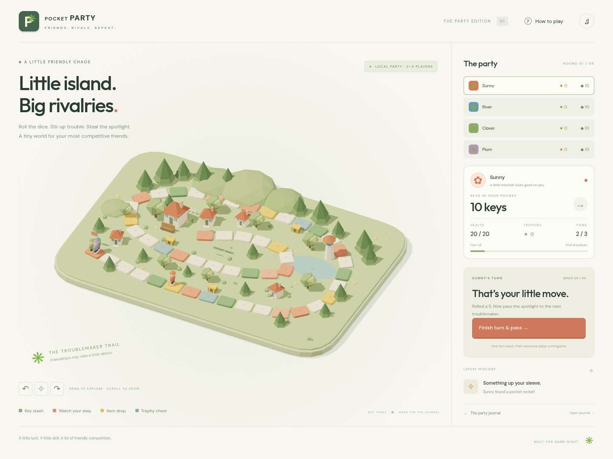
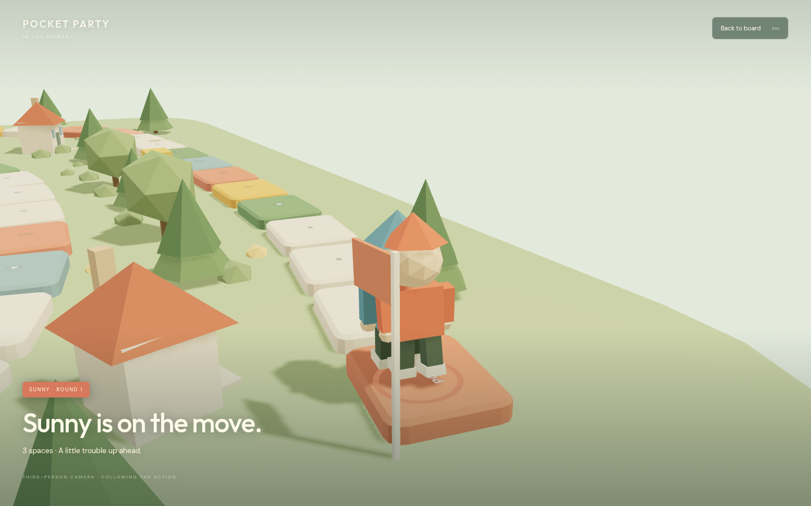

# Pocket Party

A local pass-and-play party board game for **2–4 people**, inspired by the competitive board-and-minigame format of Pummel Party. Original low-poly island, animated characters, items, trophy chests, and three alternating skill minigames.

Python runs all rules, turns, item effects, random rolls, scores, rewards, and SQLite saves. Three.js renders the browser view. JavaScript handles input and visual animation.

## Run

Python 3.10+ and a browser with WebGL2. No pip or npm installation required.

```sh
python server.py --port 3000 --open
```

Run the command from this directory, or pass the absolute path to `server.py` from any directory. On Windows, double-click **Play Game.bat**; on macOS/Linux, use `python3` if needed. The browser opens automatically, or open http://127.0.0.1:3000 manually. Keep the server console running. Choose 2–4 players, enter names, and start. Share one device, handing it over when prompted. Progress automatically saves in `saves.sqlite3` and resumes using a browser cookie. Start a new party from the party journal.

The server binds only to the local device by default. Use `--port 3001` if the port is occupied, and `--data-dir /path/to/saves` to choose another save location. The application runs with the Python standard library on Windows, macOS, and Linux; the browser must support WebGL2.





## Rules

- **8 rounds.** Everyone gets one board turn, followed by a minigame with individual attempts.
- **Most trophies wins**, with keys breaking ties. Exact ties share the win.
- On your turn, optionally use one item **before rolling**, then move 1–6 spaces. Collect keys, find items, heal, or hit traps. The trail’s end is a portal back to its start.
- Passing a chest offers a trophy for **20 keys**.
- **Pocket rocket:** 7 damage. **Key magnet:** steal up to 8 keys. **Switcheroo:** swap positions. **Bubble shield:** block one attack or trap. Inventory holds three items.
- At zero health, lose up to 8 keys and respawn at the start with 20 HP. Keep your trophies.
- After each minigame, the top score earns a trophy (ties share it). Key rewards by rank are 10, 7, 4, and 2. Equal-score key ranks favor earlier players.

## Minigames

1. **Sweet spot:** stop the moving marker near the center. Click or Space.
2. **Gem scramble:** view a grid for three seconds, then recall the number of gold gems.
3. **Pocket rush:** tap or press Space as often as possible in five seconds. Holding a key does not count as repeated taps.

These are sequential, single-device skill challenges. The game does not include network multiplayer or simultaneous arena combat.

## 3D & controls

Drag to orbit, scroll to zoom, or use camera buttons. Moves automatically switch to a full-screen third-person perspective camera that follows the running character. Landing, pickups, trophies, shields, and attacks have close-up animations, followed by a smooth return to the board. Use **Back to board** or **Escape** to skip; reduced-motion settings keep the overview. Each colored character has a root, body, independently animated arm/leg pivots, and a visible shield bubble. Original procedural scenery includes hills, trees, houses, water, a lighthouse, chests, and the board. Sound starts muted. Reduced-motion preferences are honored during board movement.

## Verification

```sh
python -m unittest discover -s tests -v
```

Tests cover setup, handoffs, turn validation, attacks, shields, knockouts, theft, chests, portal wrapping, and complete seeded parties. HTTP integration tests additionally verify asset serving, session isolation, save persistence, invalid requests, and launching outside the game directory. The GitHub Actions workflow runs these tests on Windows and Ubuntu with Python 3.10 and 3.12. Development browser checks covered a full party, all minigames, targeted attacks, third-person running/pickups, overview transitions, and animation skipping. Selected screenshots are in `docs/screenshots/`.

## Assets

All models, geometry, textures, and synthesized sounds are original; no Polyfork assets or model attribution are needed. Three.js is MIT licensed with its notice preserved in `static/vendor/THREE-LICENSE.txt`. DM Sans and Outfit are optionally loaded from Google Fonts, with system fallbacks. This is an original game, not affiliated with Pummel Party or a commercial board-game publisher.
